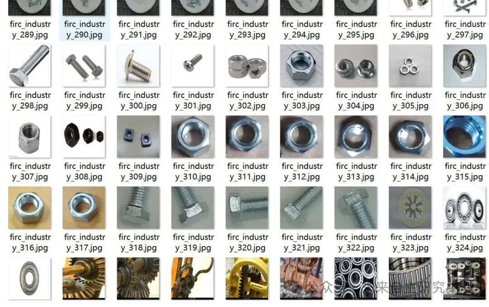
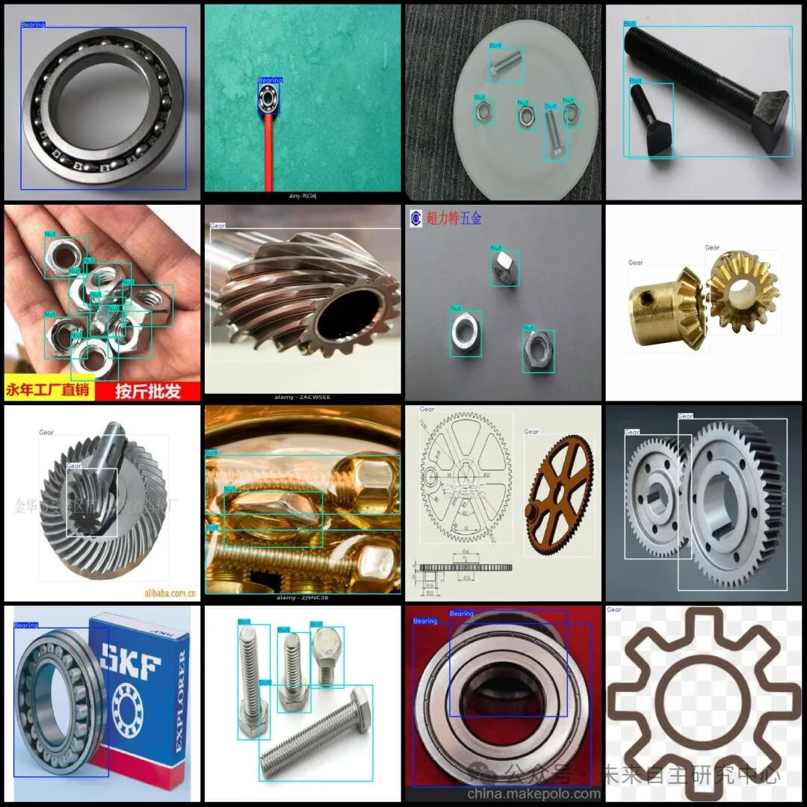

# Intelligent Factory Bearing, Gear, Nut, and Bolt Detection Dataset in VOC+YOLO format with 2249 images across 4 categories

Dataset format: Pascal VOC format + YOLO format (txt file without split path, only containing jpg images and corresponding VOC format xml files and yolo format txt files)

Number of images (number of jpg files): 2249

Number of annotations (number of xml files): 2249

Number of annotations (number of txt files): 2249

Labeling category count: 4

Label category names (Note that the order of yolo format categories does not correspond to this, but is based on the labels folder's classes.txt): ["Bearing", "Bolt", "Gear", "Nut"]

Number of boxes labeled in each category:

Number of bearings = 2099

Bolt Frame Count = 2734

Gear Frame Count = 2662

Nut Frame Count = 3102

Total frames: 10597

Using labelImg:

Annotation rules: Draw a rectangle around the category.

Important Notice: No

Special : This dataset does not guarantee the accuracy or precision of the trained models or weight files. The dataset is provided with accurate and reasonable annotations only.

Image Preview:

Annotation Examples (randomly select 16 images for display):

## Payment

Here is a pay link on Stripe ( https://buy.stripe.com/3cs8yP7sY87d0vu9AB ). Please contact me lonlonago@foxmail.com after funding $89, and I will send you a complete data files , thank you!

